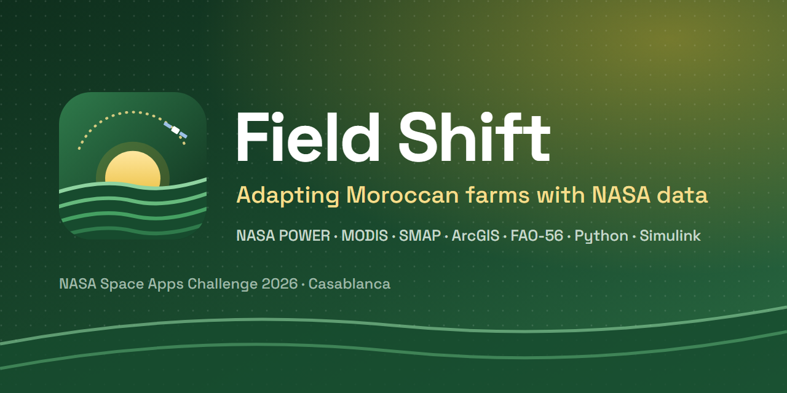
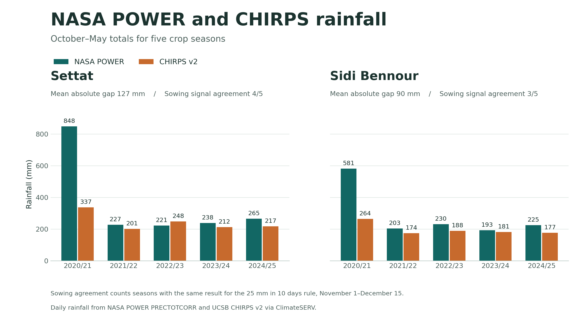

# Field Shift

**NASA Space Apps Challenge 2026, Casablanca: "Field Shift: Adapting Farms with NASA Data"** · [Live app](https://field-shift-self.vercel.app)

Morocco's climate has shifted, but most farmers still grow wheat after wheat.
Field Shift is a decision-support tool that uses NASA data to help farmers explore crop rotations that protect soil and hold up in dry years:

- **compare rotations**: 4 strategies including the current one, replayed on the real 2011-2025 seasons, ranked by the farmer's priorities (income, dry years, water, soil), with why, evidence, benefits, risks and information gaps
- **what if**: replay the same seasons with less rain or more spring heat
- **see it from space**: NASA MODIS vegetation and SMAP soil moisture layers on the map, wet spring 2018 vs dry spring 2023
- **what changed**: rainfall, dry seasons and spring heat over 35 years
- **crops and income**: single-crop scores, yield ranges and an income simulator
- **field check**: a low cost soil sensor that compares the satellite estimate with the farmer's plot

What the data shows for Chaouia (Settat), 1991-2005 compared with 2011-2025:
hot spring days (≥ 30 °C) went from 13.5 to 18.4 per year, dry seasons (< 250 mm) went from 1 to 3, and 3 of the last 4 seasons were dry.

## Repository

```
app/           web app (React + Vite + ArcGIS Maps SDK)            -> software
data/          NASA POWER download + rotation and crop model (Node.js)
data-science/  Python pipeline: sowing rain, cereal screening, ML (handoff/ = outputs used by the app)
sensor/        ESP32 soil sensor code, Simulink model, 3D enclosure -> engineer
docs/          data-format.md: the JSON contract between all three
```

## Data science method (Planting time)

- **Data**: 20 years of NASA POWER daily rainfall and temperature (2006-2025) for Settat (Chaouia) and Sidi Bennour (Doukkala), 7,305 daily records per site.
- **Sowing signal**: at least 25 mm of rain over 10 consecutive days (INRA Morocco). Both sites had a qualifying window during Nov 1 - Dec 15 in 15 of 19 complete seasons. In the rainfed screening (sowing signal + seasonal rain vs. crop water demand), barley ranked above wheat at both sites.
- **Machine learning**: one logistic regression per site, trained on 2006-2020, estimating the chance of the first qualifying rain spell in the next 14 days from the day of autumn and the last 10 days of rain and temperature.
- **Evaluation**: model and historical baseline scored on the same daily forecast dates over five held-out autumns (2021-2025), Brier score, each autumn weighted equally (lower is better).

| Site | Daily test forecasts | Logistic regression | Historical baseline |
|---|---:|---:|---:|
| Settat | 219 | 0.259 | **0.253** |
| Sidi Bennour | 211 | 0.253 | **0.235** |

The baseline stays the main indicator in the app; the model is shown as an experiment.

**Rainfall cross-check** ([data-science/validation](data-science/validation)): NASA POWER vs UCSB CHIRPS v2 for 2020/21-2024/25. October-May totals agree within 50 mm in 4 of 5 seasons at both sites (NASA POWER slightly wetter); 2020/21 is the outlier. Sowing-rain answer agrees in 4/5 seasons (Settat) and 3/5 (Sidi Bennour).



## Run it

Requires Node 18+.

```bash
# 1. data (optional: the processed files are already in app/public/data)
cd data
npm run all        # downloads NASA POWER daily data, builds the JSON outputs, copies them to the app

# 2. app
cd ../app
npm install
npm run dev        # http://localhost:5173
```

## Data and method

- **NASA POWER** daily point data (power.larc.nasa.gov), 1990-2025: temperature, max temperature, bias-corrected precipitation, root zone soil wetness (GWETROOT).
- Daily values are aggregated by month and by agricultural season (Oct to Sep).
- **Crop model (rule-based v1)**: for each crop and season, a score from 0 to 100 combines
  - water: effective rainfall over the growing months vs. crop water needs (60 %)
  - heat: mean daily max temperature during flowering vs. the crop's limit (25 %)
  - soil: root zone soil wetness (15 %)
- Scenarios: `baseline` (1991-2005), `recent` (2011-2025, used as the expectation for next season), `dry_year` (driest recent season).
- Crop water needs, heat limits, yields, prices and costs are first estimates in `data/pipeline/crops.mjs` and should be checked with an agronomist.

## Use of AI

This project was built with the help of Claude (Anthropic), an AI assistant. Under the team's direction it wrote most of the web app and data pipeline code, the French translation, the slide layout and first drafts of the texts. The team chose the problem, the region, the rotations and the approach, and reviewed and tested every output. The data science analysis (`data-science/`) and the Simulink model and 3D concept render (`sensor/`) are the team members' own work. The app contains no generative AI: all results come from a transparent rule-based model on NASA data. No AI-generated images are used. Details: [docs/submission.md](docs/submission.md#use-of-artificial-intelligence).

## Team

- **Mohamed Amjad Eddaniaoui**: software, web app, team lead
- **Abdelbari Benouarrak**: data science (Python pipeline, sowing rain model, crop data review)
- **Amine Morine**: mechatronics (Simulink irrigation simulation, ESP32 soil sensor, 3D concept of the field unit)

## Tools

NASA POWER · NASA GIBS (MODIS NDVI, SMAP) · Esri ArcGIS Maps SDK for JavaScript · React · Vite · Recharts · framer-motion · Python · MATLAB / Simulink · ESP32 / Arduino
