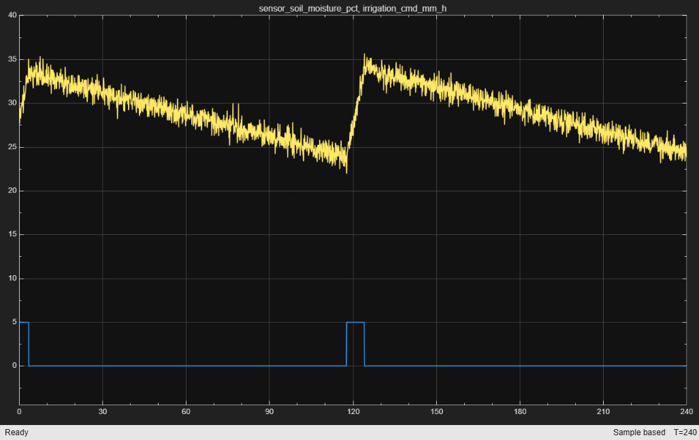
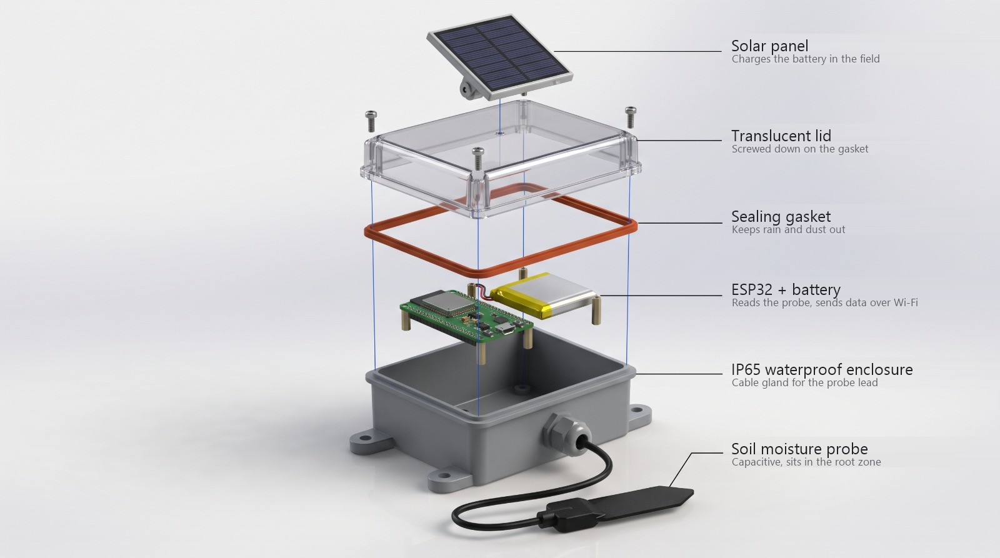

# Sensor

Low cost soil sensor that checks the satellite soil moisture at field level.

## Parts (approximate prices in Morocco)

| Part | Approx. price |
|---|---|
| ESP32 dev board | 70-90 MAD |
| Capacitive soil moisture sensor v1.2 | 20-30 MAD |
| DS18B20 waterproof temperature probe | 25-35 MAD |
| 4.7 kΩ resistor, wires, small box | 20 MAD |
| **Total** | **≈ 150 MAD** |

Prices are rough estimates, check them with a local shop before putting them in the slides.

## Wiring

- Moisture sensor: VCC → 3.3V, GND → GND, AOUT → GPIO 34
- DS18B20: red → 3.3V, black → GND, yellow (data) → GPIO 4, with a 4.7 kΩ resistor between data and 3.3V

## Run it

1. Install the ESP32 board package and the `OneWire` + `DallasTemperature` libraries in the Arduino IDE.
2. Open `esp32_soil_sensor/esp32_soil_sensor.ino`, put your WiFi name and password.
3. Calibrate: note the raw value in dry air and in water (print `analogRead(34)` in Serial), update `RAW_DRY` and `RAW_WET`.
4. Upload, open the Serial monitor, copy the address it prints (`http://<ip>/reading`).
5. Run the app locally (`npm run dev` in `/app`), go to **Field sensor**, paste the address, click **Connect**.

The laptop and the ESP32 must be on the same WiFi. The output format is in `docs/data-format.md` (section 4).

## No hardware?

- The app already shows simulated readings from `app/public/data/sensor_sample.json`.
- Simulink: model the sensor + an irrigation rule (irrigate when moisture < threshold) and show how much water it saves.
- SOLIDWORKS: design the enclosure (stake in the ground, waterproof box for the ESP32, small solar panel) and export a render for the slides.

## Ideas for the engineer

- Battery + deep sleep, one reading every 30 minutes.
- Calculate water needs per crop from `data/output/<region>/recommendations.json` (`irrigation_mm`).

## Simulink model (smart irrigation)

[simulink/simulation_du_projet.m](simulink/simulation_du_projet.m) builds, runs and exports the Simulink model `Smart_Irrigation_Model` (MATLAB + Simulink R2021a+):

- Soil: FAO-56 root-zone water balance, dθ/dt = 100/Zr × (I + P − Kc·ET0), Zr = 300 mm, Kc = 1.15 (tomato), ET0 = 0.22 mm/h, no rain, θ limited to 10-45 %.
- Sensor: ESP32 reading = θ + band-limited white noise (covariance 0.05, Ts 0.1 h).
- Controller: relay, valve 5 mm/h on below 22 %, off above 35 %.
- Result (10 days): moisture 22.0-35.6 %, 49.3 mm applied in 9.9 h of valve time, against about 61 mm of crop water use.

`regenerate_series.js` rebuilds the displayed time series from the same equations with seeded noise (the app shows the MATLAB summary values).

## Enclosure (3D model)

Exploded view, parts and known limits: [enclosure/README.md](enclosure/README.md).

