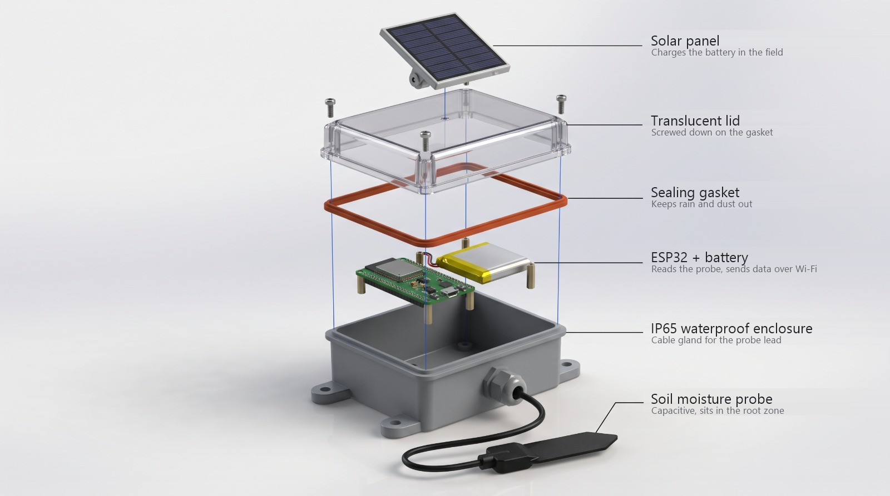

# Field unit (3D concept)

3D concept assembly and render by Amine Morine (SolidWorks), built from standard component models downloaded from CAD libraries (not redistributed here).

## Parts chosen for the prototype

| Part | Notes |
|---|---|
| IP67 junction box (Gratury, off the shelf) | Opaque hinged lid, rubber seal, steel latches, internal mounting plate for the boards |
| ESP32-WROOM, 30 pins, USB-C | Reads the probe, sends readings over Wi-Fi, sleeps between readings |
| LiPo battery, 500 mAh | 3.7 V nominal |
| 5 V mini solar panel | 53 × 30 mm cell in the model |
| Capacitive soil moisture probe v1.2 | No exposed metal in the soil, so no corrosion |

The render shows a concept with a clear screwed lid. The prototype uses the off-the-shelf IP67 box above instead.

## Design choices and what the next version adds

- Heat: a clear lid in the Moroccan sun can push the inside above 60 °C, too hot for a LiPo. Hence the opaque lid; a LiFePO4 cell would add margin.
- Two cable glands: probe and solar lead.
- A solar LiPo charge module: the panel cannot charge the battery directly and the ESP32 board has no charger.
- The probe electronics are not waterproof: seal them in the head, only the sensing blade goes in the soil.
- Deep sleep, one reading every 30 minutes, so a small panel is enough.
- Range: Wi-Fi rarely reaches the middle of a field; LoRa would carry the readings to the farm.

Files: `enclosure_render_original.jpg` (render as exported), `enclosure_en.png` / `enclosure_fr.png` (corrected labels, used in the app and slides).
